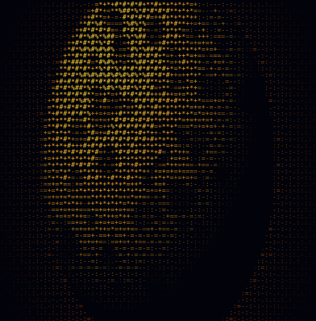

  

# Saksham Srivastava

I build at the layers most people never see: FPGA tooling, bare-metal
firmware, compilers. Computer Engineering @ USF (math minor), Tampa FL,
graduating May 2027.

[Portfolio](https://portfolio-eight-beta-78.vercel.app) · [Email](mailto:saksham146053@gmail.com) · [LinkedIn](https://www.linkedin.com/in/sakshamsriv)

## Proof, not promises

- **[Helion](https://github.com/helion-fpga/helion)** is an FPGA CAD suite I
  wrote in Rust: synthesis, packing, placement, PathFinder routing, timing
  analysis, bitstream generation, one binary, targeting my own HL10T die.
  Measured: AES-128 routes at 80% die utilization (6,534 LUTs) and the flow
  runs 3-100x faster than Yosys + nextpnr on identical RTL, with every caveat
  published next to the numbers.
- **nRF52840 sensor node**: BLE telemetry firmware in MISRA C:2012, 100 Hz
  IMU pipeline, portable protocol layer with host unit tests, watchdog fed
  only on proven thread liveness. Zero dropped packets, verified by sequence
  number.
- 168/168 engine tests green; a QoR gate fails the build if LUT counts or
  timing move without a reason recorded in the same commit.

## Selected builds

**[automix](https://github.com/saksham-45/automix)** - neural DJ engine: a
decision network picks the move, an LSTM predicts the transition curve.
*Python, PyTorch, Librosa.*

**[Mathon](https://github.com/saksham-45/Mathon)** - a scientific computing
DSL and compiler: lexer to AST to LLVM IR to JIT, with symbolic
differentiation and autodiff. *Python, llvmlite.*

**[MoodScope](https://github.com/saksham-45/MoodScope)** - real-time emotion
detection over webcam, PyQt dashboard, insights from a local Llama 3.2.
*Python, TensorFlow, OpenCV.*

**[isomercount](https://github.com/saksham-45/isomercount)** - exact
combinatorial enumeration with transfer matrices and Burnside's lemma.
*Python, NumPy, SymPy.*

**[introvertensemble](https://github.com/saksham-45/introvertensemble)** -
agent-based simulation of library seating: eight personas, multi-factor seat
scoring, seeded reproducible runs. *Python.*

**[visualizzer](https://github.com/saksham-45/visualizzer)** - audio-reactive
WebGL visuals driven by a 2048-point FFT at 60fps.
[Live demo.](https://visualizzer.vercel.app/) *JavaScript, WebGL2.*

**Covid-Help** - founded and led a volunteer platform connecting COVID
patients with resources (2021).

Also: voiceagents (Qt/C++
voice control for LMMS), docker-android, container-xrdp.

## Stack

`Rust` · `C` · `C++` · `SystemVerilog` · `Python` · `C#` · `JavaScript` · `Swift` · `Bash`
`PyTorch` · `TensorFlow` · `NumPy` · `SymPy` · `OpenCV` · `Librosa` · `LLVM`
`Three.js` · `Qt` · `Docker` · `Linux` · `Git`
