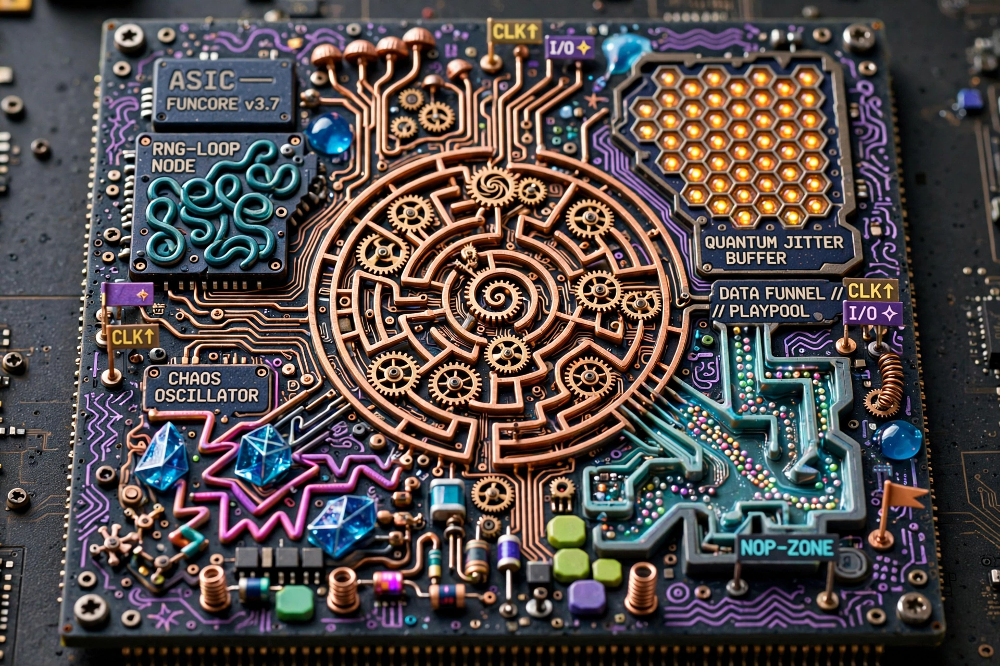

# Saksham Srivastava

Computer Engineering @ University of South Florida (math minor), Tampa FL.
I work the whole stack — silicon, firmware, compilers, web — but my heart
is in the layers most people never see. Currently building an FPGA CAD suite
in Rust and writing firmware that gets graded on code quality.

[Portfolio](https://portfolio-eight-beta-78.vercel.app) · [Email](mailto:saksham146053@gmail.com) · [LinkedIn](https://www.linkedin.com/in/sakshamsriv)

---

## Currently on the die

**[Helion](https://github.com/helion-fpga/helion)** — the complete FPGA flow
(synthesis → packing → placement → PathFinder routing → timing → bitstream)
in a single Rust binary, targeting my own HL10T die. Measured, not claimed:
AES-128 routes at 80% die utilization (6,534 LUTs), and the flow runs 3–100×
faster than Yosys + nextpnr on identical RTL — caveats printed right next to
the numbers, because that's how it should be.

**nRF52840 sensor node** — BLE telemetry firmware written to MISRA C:2012
and JPL's Power of Ten: a 100 Hz IMU pipeline, a portable protocol layer
with host unit tests, and a watchdog fed only on proven thread liveness.
Streams at ~13 Hz with zero drops, verified by sequence number.

**Covid-Help** — founded and led a volunteer platform connecting COVID
patients with resources (2021).

## The rest of the wafer

**[automix](https://github.com/saksham-45/automix)** — neural DJ engine: a
decision network picks the move, an LSTM predicts the transition curve.
Harmonic analysis, micro-timing alignment, stem-aware blending.
*Python, PyTorch, Librosa.*

**[Mathon](https://github.com/saksham-45/Mathon)** — a scientific-computing
DSL and compiler: lexer → AST → LLVM IR → JIT, with symbolic
differentiation and dual-number autodiff. *Python, llvmlite.*

**[MoodScope](https://github.com/saksham-45/MoodScope)** — real-time emotion
detection over webcam, PyQt5 dashboard, personal insights via local
Llama 3.2. *Python, TensorFlow, OpenCV.*

**[isomercount](https://github.com/saksham-45/isomercount)** — exact
combinatorial enumeration via transfer matrices, Burnside's lemma, and
Möbius filtering. *Python, NumPy, SymPy.*

**[introvertensemble](https://github.com/saksham-45/introvertensemble)** —
agent-based simulation of library seating: eight personas, multi-factor
seat scoring, seeded reproducible runs. *Python.*

**[visualizzer](https://github.com/saksham-45/visualizzer)** — audio-reactive
WebGL visuals, 2048-point FFT at 60fps.
[Live demo.](https://visualizzer.vercel.app/) *JavaScript, WebGL2.*

Also: [lab-minsk-compiler](https://github.com/saksham-45/lab-minsk-compiler)
(C#/.NET compiler and REPL), [voiceagents](https://github.com/saksham-45/voiceagents)
(Qt/C++ voice control for LMMS), [docker-android](https://github.com/saksham-45/docker-android)
and [container-xrdp](https://github.com/saksham-45/container-xrdp) (container hardening).

---

## Fab notes

`Rust` · `C` · `C++` · `SystemVerilog` · `Python` · `C#` · `JavaScript` · `Swift` · `Bash`
`PyTorch` · `TensorFlow` · `NumPy` · `SymPy` · `OpenCV` · `Librosa`
`LLVM` · `Three.js` · `Qt` · `Docker` · `Linux` · `Git`
